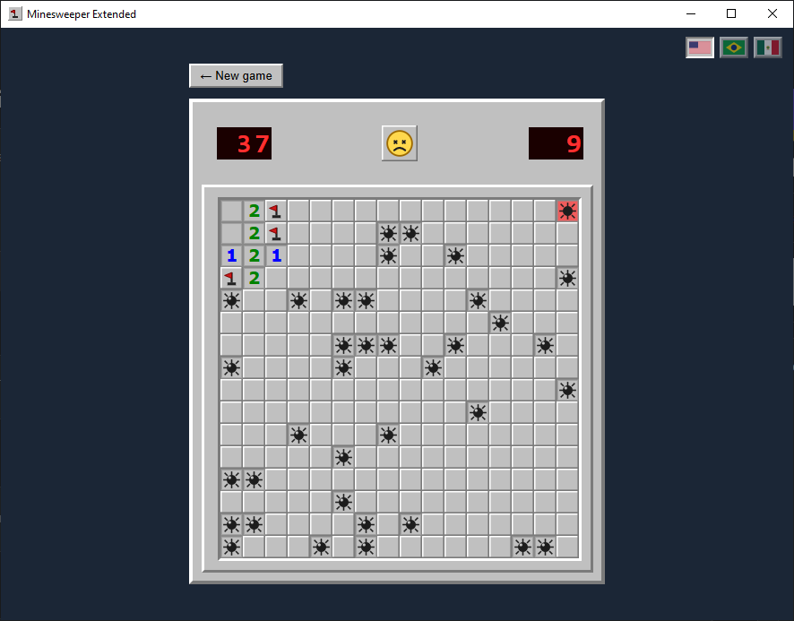

# Minesweeper

## About

I wrote the first version of this Minesweeper in 2008, in Java with Swing, as a project for Programming Fundamentals 1 (Fundamentos de Programação 1), a course in the Computer Engineering program at the Federal University of Technology - Paraná (Universidade Tecnológica Federal do Paraná).

Years later I decided to bring it back and ported it to TypeScript. It now runs as a desktop app built with [Wails](https://wails.io), with a React frontend and a small Go backend that just hosts the window. The game logic all lives in the frontend.

Besides the classic single-player mode, there is a turn-based versus mode where you can play against a friend or against the computer (easy, medium or hard), similar to the old two-player Minesweeper available at MSN Messenger.



## Prerequisites

- Go 1.26 or newer: https://go.dev/dl/
- Node.js 16 or newer (comes with npm): https://nodejs.org/
- Platform dependencies:
  - Windows: WebView2 Runtime. It ships with Windows 11; on Windows 10 get it from
    https://developer.microsoft.com/microsoft-edge/webview2/
  - macOS: Xcode Command Line Tools (`xcode-select --install`)
  - Linux: `gcc`, `libgtk-3` and `libwebkit2gtk-4.0` (see
    https://wails.io/docs/gettingstarted/installation)

## Installing Wails

Install the Wails CLI with Go:

```bash
go install github.com/wailsapp/wails/v2/cmd/wails@latest
```

Make sure your Go bin directory is on your `PATH`:

```bash
# Linux/macOS
export PATH=$PATH:$(go env GOPATH)/bin

# Windows (PowerShell)
$env:Path += ";$(go env GOPATH)\bin"
```

Then check that everything is in place:

```bash
wails version
wails doctor
```

`wails doctor` will tell you if any system dependency is missing.

## Building on Linux

On a fresh Ubuntu, install the toolchain and build dependencies before building.

1. System build dependencies (GTK + WebKit, compiler, installer tooling):

   ```bash
   sudo apt update && sudo apt install -y \
     pkg-config libgtk-3-dev libwebkit2gtk-4.0-dev build-essential nsis
   ```

2. Go 1.26 (installed globally into `/usr/local`):

   ```bash
   cd /tmp && curl -LO https://go.dev/dl/go1.26.0.linux-amd64.tar.gz && \
   sudo rm -rf /usr/local/go && \
   sudo tar -C /usr/local -xzf go1.26.0.linux-amd64.tar.gz && \
   echo 'export PATH=$PATH:/usr/local/go/bin:$HOME/go/bin' | sudo tee /etc/profile.d/go.sh
   ```

   Open a new shell (or `source /etc/profile.d/go.sh`) so `go` is on your `PATH`.

3. Node.js 22 (Vite 7 needs Node 20+; the Ubuntu 20.04 default is too old):

   ```bash
   curl -fsSL https://deb.nodesource.com/setup_22.x | sudo -E bash - && \
   sudo apt install -y nodejs
   ```

4. The Wails CLI:

   ```bash
   go install github.com/wailsapp/wails/v2/cmd/wails@v2.17.1
   ```

Verify everything with `go version`, `node --version`, and `wails version`, then build as described below.

## Running in development

Run `wails dev` in the project directory. It starts a Vite dev server with hot reload for the frontend. There is also a dev server at http://localhost:34115 if you want to use a regular browser and still call the Go methods from devtools.

## Building

Run `wails build` to produce a release build. The binary goes to `build/bin/` (for example `build/bin/minesweeper-extended.exe` on Windows).

Some useful flags:

```bash
wails build -clean                    # clean the bin directory first
wails build -upx                      # compress the binary with UPX (needs UPX installed)
wails build -platform windows/amd64   # build for a specific platform/arch
```

## Frontend scripts

From inside `frontend/`:

```bash
npm run test     # unit tests (Vitest)
npm run lint     # lint with Biome
npm run format   # format with Biome
npm run check    # format + lint + safe fixes
```

## License

MIT. See [LICENSE](LICENSE).
